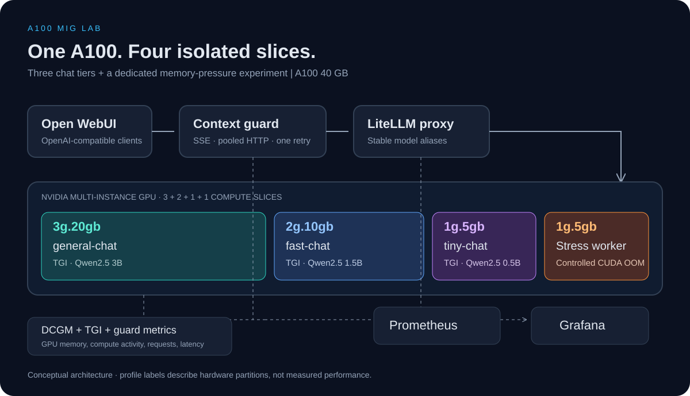

# NVIDIA A100 MIG · Multi-model LLMOps Lab

[](https://github.com/AlexeySmirnov74/mig-litellm-nvidia-a100-lab/releases)
[](https://github.com/AlexeySmirnov74/mig-litellm-nvidia-a100-lab/actions/workflows/ci.yml)


[](https://github.com/AlexeySmirnov74/mig-litellm-nvidia-a100-lab/stargazers)

**English** · [Русский](README.ru.md)

Run three independent chat models and a controlled CUDA memory-pressure experiment on **one NVIDIA A100 40GB**. The lab combines hardware partitioning, an OpenAI-compatible gateway, a streaming context-recovery service, and GPU/application observability.



## The experiment

Can one physical GPU serve different LLM tiers while a separate workload exhausts its own GPU memory? This lab provides the deployment and test procedure to investigate that question.

| MIG profile | Workload | Model | Input / total token limit |
| --- | --- | --- | --- |
| `3g.20gb` | `general-chat` → TGI | Qwen2.5 3B Instruct | 1536 / 2048 |
| `2g.10gb` | `fast-chat` → TGI | Qwen2.5 1.5B Instruct | 768 / 1024 |
| `1g.5gb` | `tiny-chat` → TGI | Qwen2.5 0.5B Instruct | 384 / 512 |
| `1g.5gb` | Dedicated stress worker | CUDA allocations / memory pressure | — |

MIG partitions compute and GPU memory resources. Each TGI container receives one specific MIG UUID; the stress worker uses a fourth UUID. Model aliases select a tier explicitly. Context recovery retries the **same tier** once; it does not route to a larger model.

**Engineering demonstrated:** Linux GPU provisioning, scoped infrastructure automation, container orchestration, async HTTP/SSE, bounded recovery policies, failure experiments, Prometheus/Grafana, and GPU-free CI.

## Recorded demonstration

These are **original screenshots preserved from the earlier A100 experiment**, not new measurements of this release. They document the original UI and deployment; there is no archived benchmark dataset sufficient to claim a reproducible speedup or unchanged neighbour latency.


*Three model aliases in Open WebUI. The historical recovery message describes the earlier implementation; the current guard compacts only the retried request and does not erase browser history.*


*Historical application dashboard. GPU utilization shown as zero in the old dashboard is not evidence of idle MIG instances; this release corrects missing-data handling and uses DCGM profiling activity.*

<details>
<summary>More original screenshots: MIG layout, GPU processes, and memory occupancy</summary>


</details>

## Reproduce on an A100 host

Use a **dedicated Linux host with an A100 40GB**, working NVIDIA driver and `nvidia-smi`, internet access for images/models, Bash, Git, and sudo. Ubuntu 22.04/24.04 is the intended platform. MIG must be exposed by your provider; a normal GPU VM with no MIG administration access is insufficient. This layout targets the 40GB card; A100 80GB has different profiles.

Docker Compose **2.23.1+** is required for an environment-backed monitoring secret. The host bootstrap installs Docker and NVIDIA Container Toolkit; it leaves GPU driver installation to your provider.

```bash
git clone https://github.com/AlexeySmirnov74/mig-litellm-nvidia-a100-lab.git
cd mig-litellm-nvidia-a100-lab
cp .env.example .env
# Edit .env: replace OPENAI_API_KEY, OPENWEBUI_SECRET_KEY, GRAFANA_ADMIN_PASSWORD.
# HF_TOKEN is optional for the default public models.
sudo bash scripts/00_host_prereqs.sh
sudo env GPU_ID=0 bash scripts/01_enable_mig.sh
sudo env GPU_ID=0 bash scripts/02_create_layout.sh
GPU_ID=0 bash scripts/03_export_env.sh
GPU_ID=0 bash scripts/04_validate_host.sh
bash scripts/05_start_stack.sh
bash scripts/06_demo_queries.sh
```

Enabling MIG on A100 can require a GPU reset or reboot. If requested, reboot before creating the layout. The script creates `3g` first, as specified by [NVIDIA's geometry guidance](https://docs.nvidia.com/datacenter/tesla/mig-user-guide/getting-started-with-mig.html#instance-geometry). Existing MIG instances require explicit `MIG_RESET=1` to rebuild, after stopping their workloads:

```bash
sudo env GPU_ID=0 MIG_RESET=1 bash scripts/02_create_layout.sh
GPU_ID=0 bash scripts/03_export_env.sh
```

Re-export UUIDs after every layout change or reboot/recreation. Model revisions are pinned in `.env.example`; if changing a model, also select its revision and re-evaluate memory/token limits. First boot downloads weights and can take several minutes. Use `./get_logs.sh` to inspect startup, and run the smoke queries only after all model servers are healthy.

All published ports bind to `127.0.0.1` by default. From your workstation:

```bash
ssh -L 3000:127.0.0.1:3000 -L 3001:127.0.0.1:3001 \
    -L 4000:127.0.0.1:4000 -L 4010:127.0.0.1:4010 -L 9090:127.0.0.1:9090 user@SERVER_IP
```

| Service | Local address | Purpose |
| --- | --- | --- |
| Open WebUI | http://localhost:3000 | Chat with the three model aliases |
| Grafana | http://localhost:3001 | Provisioned LLMOps and MIG dashboards |
| Context guard | http://localhost:4010/v1 | Recommended OpenAI-compatible client endpoint |
| LiteLLM | http://localhost:4000/v1 | Direct gateway, without context recovery |
| Prometheus | http://localhost:9090 | Target health and raw metrics |

Open WebUI disables public signup by default. If your version needs first-account enrollment, enable signup temporarily through the SSH tunnel, create the administrator, then disable it again. Set `BIND_HOST=0.0.0.0` only when you have configured access controls, a firewall and TLS.

## Run the experiments

1. Send the same short prompt to each alias; check successful responses and model-specific request counters.
2. Keep smoke queries or fixed text traffic running on the serving slices.
3. Start `make stress-on`; capture its logs and MIG memory metrics. Stop it with `make stress-off`.
4. Confirm a **CUDA allocation OOM** on the stress slice, then check HTTP successes/errors and latency on all serving tiers. Host RAM exhaustion, a driver reset, or a killed process alone do not prove MIG memory isolation.
5. Compare traffic at 10, 20 and 50 users under identical prompts and generation limits.

```bash
make load USERS=10 DURATION=120 THINK=0.5 MODE=all TOKENS=64
make load-stop
make load USERS=50 DURATION=120 THINK=0.5 MODE=all TOKENS=64
make load-stop
make down
```

`make down` stops the stack while retaining persistent data and model cache. MIG teardown is a separate explicit operation; inspect [the scripts](scripts/) before changing hardware state.

Keep request/output tokens, concurrency, warm-up, image versions, model revisions, driver version, MIG UUIDs and error counts with every run. Hardware isolation does not guarantee identical latency under shared power/thermal constraints. See the [measurement protocol and tuning guidance](docs/best-practices.md).

## Context recovery and observability

The guard reuses an async HTTP connection pool and forwards SSE as it arrives. On a recognized context-length error, it builds one smaller request within per-tier budgets, preserving supported instructions and the latest user message where possible. Recovery is lossy, uses a conservative UTF-8 byte heuristic rather than the exact model tokenizer, and can truncate content. Tool-call histories are not compacted. A second failure is returned to the client.

Prometheus scrapes DCGM, TGI, the guard, and authenticated LiteLLM metrics every **15 seconds**. Grafana refreshes every 5 seconds. Missing GPU metrics display `N/A`; they do not become fabricated zeros. For diagnosis, check Prometheus `/targets`, exporter logs and DCGM profiling availability.

## Validate without a GPU

```bash
python -m venv .venv
source .venv/bin/activate
pip install -r requirements-dev.txt
python -m unittest discover -s tests -p 'test_*.py' -v
bash tests/test_scripts.sh
```

[GitHub Actions](https://github.com/AlexeySmirnov74/mig-litellm-nvidia-a100-lab/actions) checks Python behavior with mocked upstreams, shell automation with mocked hardware, Compose configuration, Prometheus configuration and dashboard structure. A green CI badge covers those checks. **It does not certify A100 inference, CUDA OOM isolation, or performance of v0.2.0.** No A100 is currently available to rerun those checks.

## Project notes

- TGI `3.3.1` preserves the original experiment. Hugging Face now places TGI in [maintenance mode](https://huggingface.co/docs/text-generation-inference/main/en/index); assess vLLM/SGLang for a new production deployment.
- This is a portfolio lab, with explicit operational and validation limits. No measured speedup is claimed for the software changes.
- This repository does not currently declare a code license. Model weights and third-party components have their own licenses.
- [Architecture (EN)](docs/architecture.md) · [Архитектура (RU)](docs/architecture.ru.md) · [Best practices and sources](docs/best-practices.md) · [Changelog](CHANGELOG.md) · [Release notes](docs/releases/v0.2.0.md)
