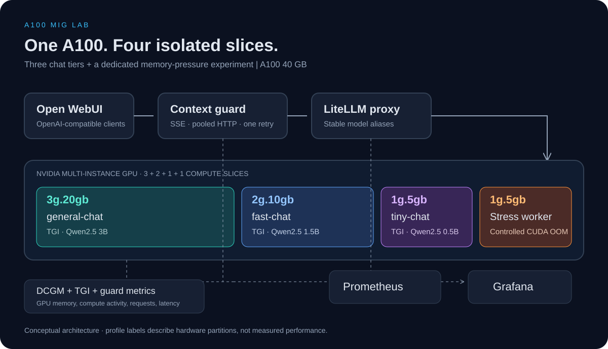

# NVIDIA A100 MIG · Лаборатория LLMOps с несколькими моделями

[](https://github.com/AlexeySmirnov74/mig-litellm-nvidia-a100-lab/releases)
[](https://github.com/AlexeySmirnov74/mig-litellm-nvidia-a100-lab/actions/workflows/ci.yml)


[](https://github.com/AlexeySmirnov74/mig-litellm-nvidia-a100-lab/stargazers)

[English](README.md) · **Русский**

Три независимые чат-модели и контролируемый эксперимент с нехваткой CUDA-памяти на **одной NVIDIA A100 40GB**. Проект объединяет аппаратное разделение GPU, OpenAI-совместимый шлюз, потоковый сервис восстановления контекста и мониторинг GPU и приложений.



## О чём эксперимент

Можно ли обслуживать несколько классов LLM на одной физической GPU, пока отдельная нагрузка исчерпывает выделенную ей видеопамять? Проект содержит конфигурацию и процедуру проверки этого сценария.

| Профиль MIG | Назначение | Модель | Лимит входа / всего токенов |
| --- | --- | --- | --- |
| `3g.20gb` | `general-chat` → TGI | Qwen2.5 3B Instruct | 1536 / 2048 |
| `2g.10gb` | `fast-chat` → TGI | Qwen2.5 1.5B Instruct | 768 / 1024 |
| `1g.5gb` | `tiny-chat` → TGI | Qwen2.5 0.5B Instruct | 384 / 512 |
| `1g.5gb` | Отдельный stress worker | Выделение CUDA-памяти / матричные операции | — |

MIG разделяет вычислительные ресурсы и GPU-память. Каждый контейнер TGI получает конкретный MIG UUID, четвёртый UUID используется только для стресс-теста. Клиент явно выбирает модель по псевдониму. При переполнении контекста запрос повторяется на той же модели один раз.

**Продемонстрированные навыки:** настройка Linux GPU-хоста, автоматизация инфраструктуры, Docker Compose, асинхронный HTTP/SSE, ограниченные политики восстановления, эксперименты с отказами, Prometheus/Grafana и CI без GPU.

## Сохранённая демонстрация

Ниже — **оригинальные скриншоты прежнего эксперимента на A100**, сохранённые из репозитория. Это не новые замеры текущего релиза. Исходного набора результатов для воспроизводимого сравнения скорости или утверждения о неизменной задержке соседних слайсов нет.


*Сообщение об очистке истории относится к старой реализации. Текущий guard сокращает только повторяемый запрос и не удаляет историю в браузере.*


*Историческая панель. Нулевые значения utilization в старой версии не подтверждают простой MIG: в этом релизе исправлено отображение отсутствующих данных и используется DCGM profiling.*

<details>
<summary>Ещё скриншоты: MIG-инстансы, процессы GPU и заполнение памяти</summary>


</details>

## Как воспроизвести на A100

Нужен **выделенный Linux-хост с A100 40GB**, рабочим драйвером NVIDIA и `nvidia-smi`, доступом в интернет для моделей и контейнеров, Bash, Git и sudo. Целевая платформа — Ubuntu 22.04/24.04. Провайдер должен разрешать управление MIG. Для A100 80GB нужны другие профили.

Требуется Docker Compose **2.23.1+**: мониторинг получает ключ через environment-backed secret. Скрипт подготовки устанавливает Docker и NVIDIA Container Toolkit, установку драйвера оставляет провайдеру.

```bash
git clone https://github.com/AlexeySmirnov74/mig-litellm-nvidia-a100-lab.git
cd mig-litellm-nvidia-a100-lab
cp .env.example .env
# Замените OPENAI_API_KEY, OPENWEBUI_SECRET_KEY, GRAFANA_ADMIN_PASSWORD.
# HF_TOKEN для стандартных публичных моделей необязателен.
sudo bash scripts/00_host_prereqs.sh
sudo env GPU_ID=0 bash scripts/01_enable_mig.sh
sudo env GPU_ID=0 bash scripts/02_create_layout.sh
GPU_ID=0 bash scripts/03_export_env.sh
GPU_ID=0 bash scripts/04_validate_host.sh
bash scripts/05_start_stack.sh
bash scripts/06_demo_queries.sh
```

При включении MIG может понадобиться сброс GPU или перезагрузка. Если скрипт сообщил об этом, перезагрузите хост до создания слайсов. Профиль `3g` создаётся первым согласно [рекомендации NVIDIA](https://docs.nvidia.com/datacenter/tesla/mig-user-guide/getting-started-with-mig.html#instance-geometry). Для пересоздания уже существующих инстансов нужно остановить их нагрузки и явно передать `MIG_RESET=1`:

```bash
sudo env GPU_ID=0 MIG_RESET=1 bash scripts/02_create_layout.sh
GPU_ID=0 bash scripts/03_export_env.sh
```

Заново экспортируйте UUID после изменения раскладки или перезагрузки с пересозданием инстансов. Ревизии моделей закреплены в `.env.example`; при замене модели укажите её ревизию и заново подберите лимиты. Первый запуск скачивает веса и может занять несколько минут. Логи доступны через `./get_logs.sh`; smoke-запросы запускайте после готовности всех TGI-сервисов.

Порты по умолчанию привязаны к `127.0.0.1`. Откройте SSH-туннель с рабочего компьютера:

```bash
ssh -L 3000:127.0.0.1:3000 -L 3001:127.0.0.1:3001 \
    -L 4000:127.0.0.1:4000 -L 4010:127.0.0.1:4010 -L 9090:127.0.0.1:9090 user@SERVER_IP
```

| Сервис | Локальный адрес | Назначение |
| --- | --- | --- |
| Open WebUI | http://localhost:3000 | Чат с тремя моделями |
| Grafana | http://localhost:3001 | Панели LLMOps и MIG |
| Context guard | http://localhost:4010/v1 | Рекомендуемый API для клиентов |
| LiteLLM | http://localhost:4000/v1 | Прямой шлюз без восстановления контекста |
| Prometheus | http://localhost:9090 | Метрики и состояние targets |

Регистрация в Open WebUI по умолчанию выключена. Если для создания первого администратора нужна регистрация, временно включите её через SSH-туннель, создайте аккаунт и снова выключите. `BIND_HOST=0.0.0.0` задавайте только после настройки доступа, firewall и TLS.

## Проведение экспериментов

1. Отправьте одинаковый короткий запрос всем трём моделям и проверьте ответы и счётчики.
2. Оставьте smoke-запросы или фиксированный текстовый трафик на serving-слайсах.
3. Запустите `make stress-on`, сохраните логи и метрики памяти. Остановка — `make stress-off`.
4. Подтвердите **CUDA allocation OOM** именно на стресс-слайсе, затем проверьте успешные HTTP-ответы, ошибки и задержки остальных моделей. Нехватка RAM хоста, сброс драйвера или завершение процесса сами по себе не доказывают изоляцию GPU-памяти.
5. Сравните 10, 20 и 50 пользователей при одинаковых prompts и лимитах генерации.

```bash
make load USERS=10 DURATION=120 THINK=0.5 MODE=all TOKENS=64
make load-stop
make load USERS=50 DURATION=120 THINK=0.5 MODE=all TOKENS=64
make load-stop
make down
```

`make down` останавливает стек с сохранением данных и кеша моделей. Удаление MIG-инстансов — отдельная явная операция. Перед изменением GPU изучите [скрипты](scripts/).

Сохраняйте токены входа/выхода, concurrency, прогрев, версии контейнеров, ревизии моделей, драйвер, MIG UUID и ошибки каждого запуска. Аппаратная изоляция не гарантирует одинаковую задержку при общих ограничениях питания и температуры. [Протокол замеров и рекомендации](docs/best-practices.md).

## Восстановление контекста и мониторинг

Guard переиспользует пул асинхронных HTTP-соединений и передаёт SSE по мере поступления. При распознанной ошибке длины контекста он создаёт один сокращённый запрос с учётом лимитов модели. По возможности сохраняются инструкции и последний пользовательский запрос. Сокращение может терять содержание: используется консервативная оценка по байтам UTF-8, а не точный токенизатор. Истории с tool calls не сокращаются. Повторная ошибка возвращается клиенту.

Prometheus опрашивает DCGM, TGI, guard и защищённые метрики LiteLLM раз в **15 секунд**. Grafana обновляется раз в 5 секунд. При отсутствии GPU-метрик отображается `N/A`. Для диагностики проверяйте `/targets` Prometheus, логи exporter и доступность DCGM profiling.

## Проверки без GPU

```bash
python -m venv .venv
source .venv/bin/activate
pip install -r requirements-dev.txt
python -m unittest discover -s tests -p 'test_*.py' -v
bash tests/test_scripts.sh
```

[GitHub Actions](https://github.com/AlexeySmirnov74/mig-litellm-nvidia-a100-lab/actions) проверяет Python с имитацией upstream, shell-автоматизацию с имитацией GPU, Compose, Prometheus и структуру dashboards. Зелёный бейдж относится к этим проверкам. **Он не подтверждает инференс на A100, CUDA OOM isolation или производительность v0.2.0.** Сейчас A100 для повторного прогона нет.

## Примечания

- Сохранён TGI `3.3.1` из исходного эксперимента. Hugging Face перевела TGI в [режим поддержки](https://huggingface.co/docs/text-generation-inference/main/en/index); для новой production-системы стоит отдельно оценить vLLM/SGLang.
- Это лабораторный проект для портфолио с указанными границами проверки. Измеренное ускорение программных изменений не заявляется.
- Лицензия на код репозитория пока не объявлена. У весов моделей и сторонних компонентов собственные лицензии.
- [Архитектура (EN)](docs/architecture.md) · [Архитектура (RU)](docs/architecture.ru.md) · [Рекомендации и источники](docs/best-practices.md) · [Изменения](CHANGELOG.md) · [Релиз](docs/releases/v0.2.0.md)
