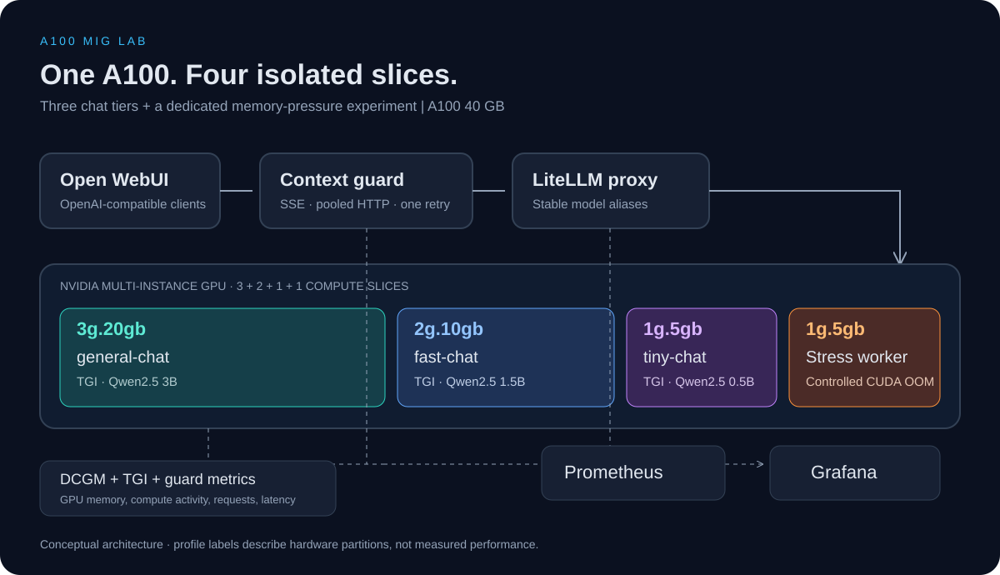

# Architecture

**English** · [Русский](architecture.ru.md) · [Reproduction guide](../README.md)

## Request path and hardware mapping

`Open WebUI / OpenAI-compatible client → context-guard → LiteLLM → TGI → MIG instance`

| Alias or workload | Container | A100 40GB profile | Default model |
| --- | --- | --- | --- |
| `general-chat` | `tgi-general` | `3g.20gb` | Qwen2.5 3B Instruct |
| `fast-chat` | `tgi-fast` | `2g.10gb` | Qwen2.5 1.5B Instruct |
| `tiny-chat` | `tgi-tiny` | `1g.5gb` | Qwen2.5 0.5B Instruct |
| Memory-pressure experiment | `stress-worker` | Separate `1g.5gb` | CUDA allocations |

Each inference container receives one MIG UUID. Clients select a model alias explicitly; context recovery never switches to a larger tier. The stress worker uses its own UUID. This geometry targets A100 40GB and must be reconsidered for other GPU variants.

The Compose stack binds published ports to loopback by default. Remote access uses an SSH tunnel. The guard sends the configured shared lab key to LiteLLM; it is a recovery proxy, not a per-user authorization service. Persistent model cache, UI data, Prometheus data and Grafana data use named volumes.

## Context recovery

The guard exposes `/v1/models` and `/v1/chat/completions`. A shared asynchronous HTTP client reuses upstream connections; normal SSE replies are forwarded incrementally.

For a recognized context-length error, eligible text-only requests receive at most one retry on the same model. The reduced request retains supported system/developer instructions and the latest user message within per-tier budgets; either may be truncated. It uses a conservative UTF-8 byte heuristic with a template reserve, not the model's exact tokenizer. It cannot guarantee a fit for arbitrary replacement models or templates.

Recovery is lossy. It changes only the retried request and does not erase browser history. Successful recovery includes a notice in the response. Tool-call histories, multimodal input and structured-output requests are not compacted. A failed retry is returned to the client; transport failures become gateway errors. Streaming latency and in-flight metrics cover the response lifetime.

## Monitoring

DCGM Exporter, TGI, LiteLLM and the guard expose metrics to Prometheus; Grafana queries Prometheus. Scraping and rule evaluation run every 15 seconds, DCGM collection is configured for 15 seconds, and dashboards refresh every 5 seconds. LiteLLM scraping uses a Bearer key mounted as a Compose secret at `/run/secrets/litellm_api_key`.

- **LLMOps Overview:** requests, latency, errors, in-flight requests, recovery attempts, framebuffer occupancy, and physical GPU temperature/power.
- **MIG Overview:** DCGM compute/tensor activity and framebuffer memory for MIG instances.
- **MIG Visual Layout:** framebuffer occupancy, memory use, compute activity, and occupancy states.

DCGM profiling activity ratios are displayed as percentages. Framebuffer values are in MiB; occupancy is `used / (used + free)`. The 85%/95% states are visual thresholds rather than OOM detection. Missing metrics remain `N/A`. Legacy A100 MIG utilization does not replace profiling activity, and board sensors do not measure independent per-instance power or temperature.

## Load and isolation experiments

The text-load workload sends concurrent requests through the guard. The stress worker allocates and fills CUDA tensors on its dedicated instance until an allocation fails. Preserve its logs, HTTP probe outcomes and telemetry to distinguish CUDA OOM from host memory exhaustion, a process kill, or a driver reset.

Measure serving tiers before, during and after stress. MIG resource isolation alone does not establish unchanged neighbour latency: the GPU board and host resources remain shared. Keep prompts, token budgets, model revisions, warm-up, load settings and software versions with every run. Follow the [measurement protocol](best-practices.md).

Original screenshots in the README record the earlier experiment. The current release has not been rerun on an A100; CPU tests do not validate GPU inference, OOM isolation or performance. TGI remains pinned for continuity and is now in maintenance mode; see the [sources and engineering limitations](best-practices.md).
