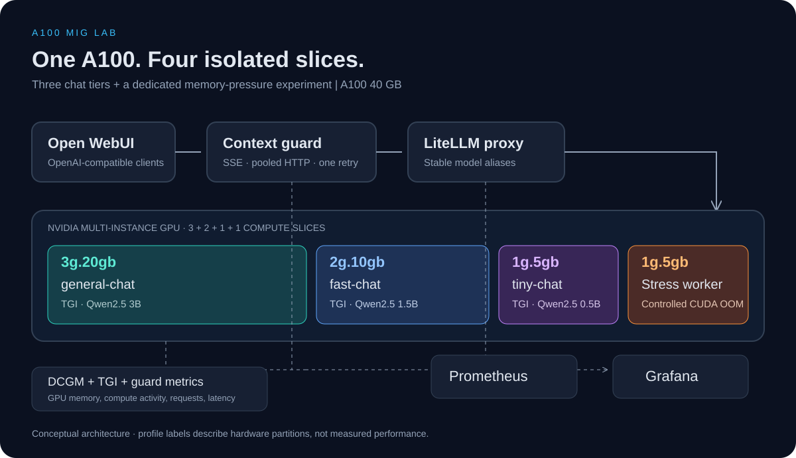

# Архитектура

[English](architecture.md) · **Русский** · [Инструкция по воспроизведению](../README.ru.md)

## Путь запроса и распределение GPU

`Open WebUI / OpenAI-совместимый клиент → context-guard → LiteLLM → TGI → MIG-инстанс`

| Псевдоним или задача | Контейнер | Профиль A100 40GB | Модель по умолчанию |
| --- | --- | --- | --- |
| `general-chat` | `tgi-general` | `3g.20gb` | Qwen2.5 3B Instruct |
| `fast-chat` | `tgi-fast` | `2g.10gb` | Qwen2.5 1.5B Instruct |
| `tiny-chat` | `tgi-tiny` | `1g.5gb` | Qwen2.5 0.5B Instruct |
| Эксперимент с нехваткой памяти | `stress-worker` | Отдельный `1g.5gb` | Выделение памяти CUDA |

Каждый сервер модели получает один MIG UUID. Клиент явно выбирает псевдоним модели; восстановление контекста не переключает запрос на более крупную модель. Стрессовая задача использует собственный UUID. Конфигурация рассчитана на A100 40GB; для других вариантов GPU её нужно пересмотреть.

Compose по умолчанию публикует порты только на loopback. Для удалённого доступа используется SSH-туннель. Guard отправляет в LiteLLM общий ключ лаборатории: он восстанавливает запросы, но не выполняет авторизацию отдельных пользователей. Кеш моделей, данные интерфейса, Prometheus и Grafana хранятся в именованных томах.

## Восстановление контекста

Guard предоставляет `/v1/models` и `/v1/chat/completions`. Общий асинхронный HTTP-клиент повторно использует соединения; обычные SSE-ответы передаются по мере поступления.

При распознанной ошибке длины контекста подходящий текстовый запрос повторяется не более одного раза на той же модели. В сокращённом запросе сохраняются поддерживаемые инструкции system/developer и последнее сообщение пользователя в пределах бюджета выбранного уровня. Их содержимое может быть обрезано. Размер оценивается консервативно по байтам UTF-8 с резервом под шаблон, без точного токенизатора модели. Для произвольной замены модели или шаблона попадание в лимит не гарантируется.

Восстановление допускает потерю части содержимого. Меняется только повторный запрос, история в браузере не удаляется. Успешный ответ после восстановления содержит уведомление. История вызовов инструментов, мультимодальный ввод и запросы со структурированным форматом ответа не сокращаются. Ошибка повторного запроса возвращается клиенту; сетевые ошибки преобразуются в ошибки шлюза. Метрики задержки и выполняющихся запросов учитывают весь срок передачи потока.

## Мониторинг

DCGM Exporter, TGI, LiteLLM и guard предоставляют метрики для Prometheus; Grafana читает их из Prometheus. Опрос и вычисление правил выполняются каждые 15 секунд, сбор DCGM настроен на 15 секунд, дашборды обновляются каждые 5 секунд. Для опроса LiteLLM используется Bearer-ключ, подключённый как Compose secret по пути `/run/secrets/litellm_api_key`.

- **LLMOps Overview:** запросы, задержки, ошибки, текущие запросы, попытки восстановления, занятость памяти и температура/мощность физической GPU.
- **MIG Overview:** активность вычислительных и тензорных блоков DCGM и память MIG-инстансов.
- **MIG Visual Layout:** занятость памяти, её использование, вычислительная активность и состояния занятости.

Коэффициенты активности DCGM отображаются в процентах. Память измеряется в MiB; занятость вычисляется как `used / (used + free)`. Уровни 85% и 95% служат визуальными порогами, а не детектором OOM. Отсутствующие метрики остаются `N/A`. Старый показатель utilization не заменяет профилирующие метрики A100 MIG; датчики платы не измеряют отдельную мощность или температуру каждого инстанса.

## Эксперименты с нагрузкой и изоляцией

Генератор текстовой нагрузки отправляет конкурентные запросы через guard. Стрессовая задача выделяет и заполняет тензоры CUDA на отдельном инстансе до отказа выделения памяти. Сохраняйте её логи, результаты HTTP-проверок и телеметрию: они помогают отличить CUDA OOM от нехватки памяти хоста, завершения процесса или сброса драйвера.

Измеряйте обслуживающие модели до, во время и после стрессовой нагрузки. Изоляция ресурсов MIG сама по себе не доказывает неизменность задержки соседних моделей: плата GPU и ресурсы хоста остаются общими. Фиксируйте запросы, лимиты токенов, ревизии моделей, прогрев, параметры нагрузки и версии ПО. Используйте [протокол измерений](best-practices.md) на английском языке.

Оригинальные скриншоты в README относятся к прежнему эксперименту. Текущий релиз повторно не запускался на A100; тесты на CPU не подтверждают GPU-инференс, изоляцию при OOM или производительность. TGI закреплён для сохранения исходной реализации и сейчас находится в режиме поддержки; подробности и официальные источники приведены в [инженерных рекомендациях](best-practices.md).
